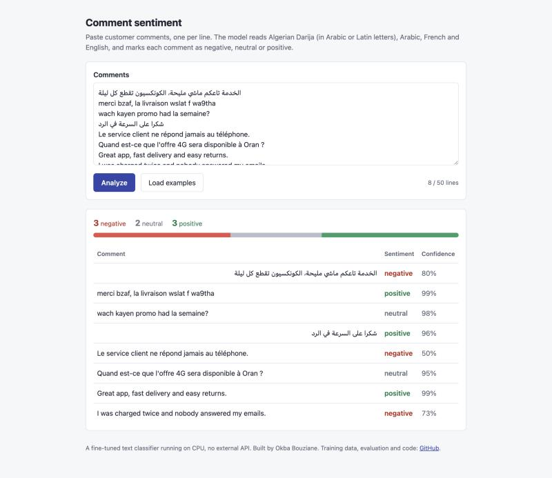
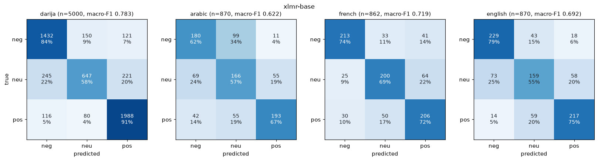

# DzSentiment

[](https://github.com/okba-bouziane/DzSentiment/actions/workflows/ci.yml)

A sentiment classifier for customer text in **Algerian Darija** (Arabic letters, Latin letters or both), **Arabic**, **French** and **English**. Two pre-trained encoders are fine-tuned on 45,516 labelled comments and tweets and compared with a TF-IDF baseline and two zero-shot LLMs. The model is scored on a held-out test set, with macro-F1 for each language and a confusion matrix. The fine-tuned XLM-RoBERTa model runs on CPU in about 30 ms per comment and calls no external API.

**Stack:** PyTorch · Hugging Face Transformers · scikit-learn · FastAPI · Kaggle (T4 GPU) for training · pytest · GitHub Actions



The demo is a plain page: paste comments, one per line, and get a label and a confidence for each. It runs locally (`make demo`). It is not hosted yet.

## Results

Mean macro-F1 over the four languages, on the test set (each language weighs the same, so Darija's 5,000 test rows cannot hide a weak language):

| System | Mean of 4 languages | Gain over TF-IDF |
| --- | --- | --- |
| TF-IDF + logistic regression | 0.591 | |
| DziriBERT, fine-tuned | 0.674 | +0.083 |
| **XLM-RoBERTa base, fine-tuned** | **0.704** | **+0.113** |

- **Fine-tuning beats the TF-IDF baseline in every language.** XLM-RoBERTa gains +0.023 on Darija, +0.132 on Arabic, +0.154 on French and +0.143 on English.
- **It also beats zero-shot LLMs.** On the same 800-row sample, fine-tuned XLM-RoBERTa scores 0.699 against 0.639 for `gpt-oss-120b` and 0.595 for `gpt-oss-20b`.
- **The dialect model wins on Darija and loses elsewhere.** DziriBERT was pre-trained on Algerian tweets. It is the best model on Darija (0.812), and much better on Darija written in Latin letters (0.795 against 0.711 for XLM-RoBERTa). It is the weakest fine-tuned model on French (0.601) and English (0.640).
- **Neutral is the hardest class in every language.** XLM-RoBERTa finds 58% of neutral Darija comments, against 84% of negative and 91% of positive ones.

### Full test set (7,602 rows)

| System | Darija | Arabic | French | English | Mean of 4 | Overall macro-F1 | Accuracy |
| --- | --- | --- | --- | --- | --- | --- | --- |
| TF-IDF + logistic regression | 0.760 | 0.490 | 0.565 | 0.549 | **0.591** | 0.690 | 0.700 |
| XLM-RoBERTa base, fine-tuned | 0.783 | 0.622 | 0.719 | 0.692 | **0.704** | 0.749 | 0.767 |
| XLM-RoBERTa base, fine-tuned, small languages x4 | 0.781 | 0.636 | 0.718 | 0.675 | **0.702** | 0.748 | 0.764 |
| DziriBERT, fine-tuned | 0.812 | 0.641 | 0.601 | 0.640 | **0.674** | 0.751 | 0.766 |

### Same 800-row sample the LLMs labelled (200 per language)

The zero-shot LLMs were run on a fixed random sample to stay inside a free API quota. Every other system is scored again on exactly those rows.

| System | Darija | Arabic | French | English | Mean of 4 |
| --- | --- | --- | --- | --- | --- |
| TF-IDF + logistic regression | 0.755 | 0.474 | 0.579 | 0.588 | **0.599** |
| Zero-shot `gpt-oss-20b` | 0.724 | 0.593 | 0.457 | 0.607 | **0.595** |
| Zero-shot `gpt-oss-120b` | 0.757 | 0.617 | 0.469 | 0.713 | **0.639** |
| XLM-RoBERTa base, fine-tuned | 0.793 | 0.590 | 0.691 | 0.721 | **0.699** |
| XLM-RoBERTa base, fine-tuned, small languages x4 | 0.790 | 0.596 | 0.711 | 0.737 | **0.708** |
| DziriBERT, fine-tuned | 0.840 | 0.665 | 0.590 | 0.637 | **0.683** |

The LLMs used Groq's API with temperature 0 and `reasoning_effort: low`, labelling 20 texts per request. Both LLMs together used 63,000 input and 21,275 output tokens for the 800 rows. No reply was unusable.

### Darija by script (full test set)

| System | Arabic letters (n=4219) | Latin letters (n=612) | Mixed (n=157) |
| --- | --- | --- | --- |
| TF-IDF + logistic regression | 0.760 | 0.720 | 0.843 |
| XLM-RoBERTa base, fine-tuned | 0.788 | 0.711 | 0.850 |
| XLM-RoBERTa base, fine-tuned, small languages x4 | 0.785 | 0.710 | 0.844 |
| DziriBERT, fine-tuned | 0.810 | 0.795 | 0.889 |

12 Darija test rows contain no letters at all (emoji or punctuation only) and are not in this table.

### Confusion matrices

Rows are the true label, columns the prediction. Each cell shows the count and the share of its row.



All systems: [TF-IDF](results/figures/confusion-tfidf-logreg.png), [XLM-RoBERTa](results/figures/confusion-xlmr-base.png), [XLM-RoBERTa x4](results/figures/confusion-xlmr-base-os4.png), [DziriBERT](results/figures/confusion-dziribert.png), [gpt-oss-20b](results/figures/confusion-zeroshot-gpt-oss-20b.png), [gpt-oss-120b](results/figures/confusion-zeroshot-gpt-oss-120b.png). Per-class F1 for every system and language is in `results/metrics.json`.

### Cost of running it

CPU only, 2 threads (the size of a free Hugging Face CPU Space), Apple M1 Pro, 200 test comments:

| System | Size on disk | One comment p50 | One comment p95 | Batch of 32, per comment |
| --- | --- | --- | --- | --- |
| TF-IDF + logistic regression | 14.9 MB | 0.6 ms | 0.9 ms | 0.1 ms |
| DziriBERT, fine-tuned | 499.5 MB | 29.4 ms | 33.3 ms | 10.06 ms |
| XLM-RoBERTa base, fine-tuned | 1134.4 MB | 29.7 ms | 35.1 ms | 12.82 ms |

Training on one Kaggle T4 GPU took 9.5 min for XLM-RoBERTa (278M parameters), 6.6 min for DziriBERT (124M) and 12.8 min for the oversampled XLM-RoBERTa run.

## Data

| Language | Source | License | Train | Validation | Test |
| --- | --- | --- | --- | --- | --- |
| Darija | [`Abdou/dz-sentiment-yt-comments`](https://huggingface.co/datasets/Abdou/dz-sentiment-yt-comments): YouTube comments from Algerian channels, labelled by hand ([paper](https://doi.org/10.3390/app132011157)) | MIT | 39,999 | 5,000 | 5,000 |
| Arabic, French, English | [`cardiffnlp/tweet_sentiment_multilingual`](https://huggingface.co/datasets/cardiffnlp/tweet_sentiment_multilingual) (XLM-T) | see its card (CC BY 3.0 and Twitter terms) | 1,839 each | 323 / 324 / 324 | 870 / 862 / 870 |

All sets use the same three labels: negative, neutral, positive. `scripts/prepare_data.py` downloads both sources at a **pinned dataset commit** and builds the splits:

- **Darija** has no official split. It is split 80/10/10 per label with seed 42, after cleaning: 13 duplicate comments removed, and 4 texts dropped because they appeared with two different labels.
- **The tweets** keep their official splits. 1 Arabic validation row and 8 French test rows were dropped because the same text was already in an earlier split.
- **Checks:** the SHA-256 of each split file is written to `results/data_stats.json`. The Kaggle run rebuilt the splits from scratch and produced identical hashes.
- **Darija test rows by script:** 4,219 in Arabic letters, 612 in Latin letters, 157 mixed.
- **Label balance:** Darija is 34% negative, 22% neutral and 44% positive. The tweets are balanced.

The data is not stored in this repository. Run `make data` to rebuild it.

## Systems compared

| System | What it is |
| --- | --- |
| TF-IDF + logistic regression | Word 1–2-grams plus character 2–5-grams, class-balanced logistic regression. C chosen on validation (2.0 out of 0.5–8). |
| Zero-shot `gpt-oss-20b` and `gpt-oss-120b` | No training. A short instruction that explains the three labels, JSON output (`dzsent/llm.py`). |
| XLM-RoBERTa base, fine-tuned | [`FacebookAI/xlm-roberta-base`](https://huggingface.co/FacebookAI/xlm-roberta-base) (MIT), all weights trained. 3 epochs, learning rate 2e-5, batch 32, linear decay with 6% warmup, max 128 tokens, fp16 on GPU. |
| XLM-RoBERTa, small languages x4 | Same settings, with the Arabic, French and English training rows repeated 4 times. Darija is 88% of the training rows otherwise. |
| DziriBERT, fine-tuned | [`alger-ia/dziribert`](https://huggingface.co/alger-ia/dziribert) (Apache 2.0), pre-trained on 1M Algerian tweets in Arabic and Latin letters. Same settings. |

For every fine-tuned model, the epoch with the best validation mean-of-4 is kept. The test set is used once, at the end. Validation mean-of-4 per epoch: XLM-RoBERTa 0.659 / 0.700 / 0.711, DziriBERT 0.677 / 0.687 / 0.686.

Every system writes `results/predictions/<name>.jsonl` (`id`, `pred`). `scripts/evaluate.py` scores them all with the same code (`dzsent/metrics.py`), and `scripts/report.py` prints the tables above from `results/metrics.json`.

## What didn't work

- **The first GPU run reported chance-level scores (about 0.33) for both models, even though the training loss went down normally.** With `group_by_length=True`, transformers 4.57 sorts the **evaluation and test** sets by length too, not only training. `predict()` then returns rows in a different order from the dataset. My metrics matched predictions to rows by position, so every score was random, and so was the "best epoch".
  - Rescoring the saved model in the right order gave 0.643 on validation.
  - The fix is `dzsent/training.py`: training batches are still grouped by length, while evaluation and prediction stay in row order. `tests/test_training.py` fails if the order changes. The stock `Trainer` returns the order `[1, 2, 3, 0, 4]` on that test's five rows.
- **Training on the laptop (Apple M1 Pro, 16 GB) was not practical.**
  - At batch 32 with padding to the longest comment in each batch, the GPU memory grew with every new batch shape until macOS swapped, and steps took 15–25 s.
  - Batch 16 with 2-step accumulation, padding lengths rounded up to a multiple of 32, regular `torch.mps.empty_cache()` and a memory watermark brought it to about 2 steps per second. That is still about 40 minutes per model.
  - Training moved to a free Kaggle T4 (`kaggle/build_kernel.py`). Predictions from the Kaggle model and from the same model loaded on the laptop agree on 500 of 500 test rows.
- **Oversampling the small languages did not help.** Repeating the Arabic, French and English rows 4 times scored 0.702 against 0.704 on the test set (Arabic +0.014, English −0.017). With one seed, both differences are within noise.
- **Zero-shot LLMs do badly on the French tweets (0.457 and 0.469).** `gpt-oss-120b` labels 52 of the 66 positive French tweets in the sample as neutral. The dataset often labels promotional or news tweets with hashtags as positive (for example `#press #seo: Nager vert avec les piscines écologiques`). A fine-tuned model learns this convention from the training labels and a zero-shot model cannot. Part of the fine-tuning gain therefore comes from learning how this dataset was annotated, not only from better language understanding.
- **One model is not best everywhere.** DziriBERT wins on Darija (especially Latin-letter Darija) and loses 0.12 on French against XLM-RoBERTa. Sending Darija to DziriBERT and the rest to XLM-RoBERTa would need a language detector, which is not built.

## Run it

Requirements: Python 3.11+ and [uv](https://docs.astral.sh/uv/). A GPU is optional (CUDA or Apple MPS). A Groq key is needed only for the zero-shot baselines.

```bash
uv sync
make data       # download pinned sources, build splits      -> data/processed, results/data_stats.json
make tfidf      # baseline                                    -> results/predictions/tfidf-logreg.jsonl
make xlmr       # fine-tune (about 10 min on a T4)            -> models/xlmr-base, predictions
make dziribert
LLM_API_KEY=... make zeroshot    # optional, uses Groq by default (LLM_BASE_URL to change)
make evaluate   # metrics.json + confusion matrices
make latency    # CPU timing + sizes -> results/latency.json
make report     # prints the README tables
make demo       # http://localhost:7860 with models/xlmr-base
```

**Training on Kaggle instead of a laptop.**

```bash
# needs the Kaggle CLI (pip install kaggle) and an API token in ~/.kaggle
python kaggle/build_kernel.py --user <kaggle-username>
kaggle kernels push -p build/kaggle-kernel
kaggle kernels output <kaggle-username>/dzsentiment-train -p build/kaggle-out
```

The job is one private script. It contains this repo's code, downloads the same pinned data, trains the three runs on one GPU, and leaves predictions and models in its output.

**Hosting the demo.** `deploy/huggingface/` has a Docker Space (CPU, port 7860). Its build downloads the fine-tuned weights from a Hub model repo (`MODEL_REPO`). `deploy/huggingface/stage.sh` prepares the folder to upload.

## Tests

```bash
make test
```

**17 tests, all passing in the last run.** No model download and no GPU needed:
- **Data:** cleaning, script detection, deterministic stratified split with no overlap, duplicate and conflicting-label removal, cross-split leak removal.
- **Metrics:** perfect scores, each language weighing the same in the mean, a missing prediction raising an error.
- **LLM baseline:** prompt building and strict reply parsing (wrong count, unknown label, no JSON).
- **Demo API:** results and counts, trimming, input limits, page and health check, with a fake classifier.
- **Training:** the evaluation-order regression test described above.

CI runs them on every push.

## Project layout

```
dzsent/        data loading and splitting, metrics, LLM prompt/parse, inference wrapper, ordered-eval trainer
scripts/       prepare_data, baseline_tfidf, baseline_llm, train, evaluate, latency, report
app/           FastAPI demo and its single HTML page
kaggle/        builds the self-contained Kaggle training job
deploy/huggingface/   Docker Space files
results/       predictions per system, metrics.json, latency.json, data_stats.json, figures/
tests/
```

## Limitations

- **The test sets are not customer-service messages.** The Darija set is YouTube comments on many topics, and the Arabic, French and English sets are tweets. The scores say how well the models follow these datasets' labels, not how they would do on a telecom or e-commerce inbox.
- **The Arabic set is tweets from many Arab countries**, not Algerian Arabic.
- **One training seed per model.** Differences of about 0.01 between fine-tuned models are not meaningful.
- **The LLM numbers come from 800 rows** (200 per language) and one prompt, with 20 texts per request. A different prompt or few-shot examples could change them.
- **No language detector.** The demo uses XLM-RoBERTa for every comment. Sarcasm and comments that are both negative and positive get a single label.
- **XLM-RoBERTa is 1.1 GB on disk.** Quantisation or distillation was not tried.

## License

Code: [MIT](LICENSE). Datasets and base models keep their own licenses (see the Data and Systems tables).
